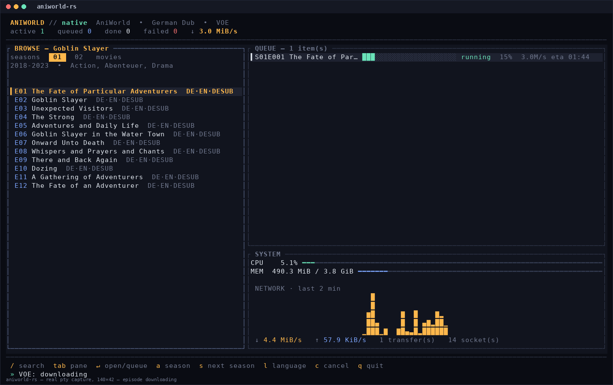
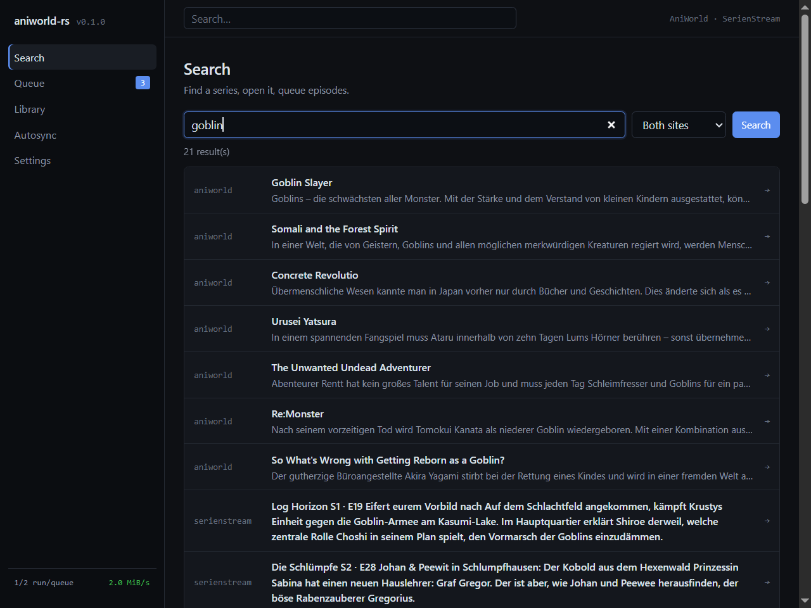

# aniworld-rs

Native Rust rewrite of [AniWorld Downloader](https://github.com/phoenixthrush/AniWorld-Downloader): parallel HLS downloads from aniworld.to and serienstream.to, a terminal dashboard and a local web UI. One binary, no Python.





## Features

- Parallel HLS segments with resume, retries and an optional bandwidth limit
- Language tracks (German/English dub and sub), VOE extraction, hoster fallback
- Terminal dashboard (`tui`): browse, queue with live progress, system panel
- Web UI (`web`): search, live queue, library playback, autosync, settings
- Jellyfin-style naming, ffmpeg muxing (without ffmpeg raw `.ts` files are kept)

## Build

Requires Rust 1.78+. `ffmpeg` is optional.

```bash
cargo build --release
```

Windows (mingw-w64 toolchain):

```powershell
rustup target add x86_64-pc-windows-gnu
cargo build --release --target x86_64-pc-windows-gnu
```

Linux, static binary that runs on any distribution (Arch, Debian, Fedora, …):

```bash
rustup target add x86_64-unknown-linux-musl
cargo build --release --target x86_64-unknown-linux-musl
```

## Usage

```bash
aniworld "https://aniworld.to/anime/stream/goblin-slayer"    # whole series
aniworld download -l "English Sub" --season 1 --episodes 1-3 <URL>
aniworld download --limit 20M -j 16 -o ~/Videos <URL>
aniworld search "goblin slayer"
aniworld info <URL>
aniworld tui
aniworld web --port 8080        # http://127.0.0.1:8080
```

A bare URL is treated as `download`. `aniworld-w` in the release ZIP is just `aniworld web`.

## Configuration

CLI flags override these environment variables:

| Variable | Default | Meaning |
| --- | --- | --- |
| `ANIWORLD_DOWNLOAD_PATH` | `~/Downloads` | download directory |
| `ANIWORLD_LANGUAGE` | `German Dub` | `German Dub`, `English Sub`, `German Sub`, `English Dub` |
| `ANIWORLD_PROVIDER` | `VOE` | preferred hoster |
| `ANIWORLD_HLS_CONCURRENCY` | cores × 2, clamped 4–16 | parallel segments per episode |
| `ANIWORLD_RETRIES` | `4` | HTTP attempts per request |
| `ANIWORLD_BANDWIDTH_LIMIT` | unlimited | `20M`, `512k`, `off` |
| `ANIWORLD_NAMING_TEMPLATE` | Jellyfin template | `{title}`, `{year}`, `{imdbid}`, `{season}`, `{episode}`, `{language}`, `{resolution}` |
| `ANIWORLD_FFMPEG` | `ffmpeg` | ffmpeg binary |
| `ANIWORLD_JOBS` | `2` | episodes downloaded at once |
| `ANIWORLD_RESUME` | `1` | reuse partial downloads |
| `ANIWORLD_SEASON_EPISODE_NUMBERS` | `0` | keep the site's seasonal index instead of the absolute number |

The web UI keeps settings and the watchlist in `~/.config/aniworld-rs/web.json` (`ANIWORLD_WEB_STATE` overrides the path) and has no login, so it binds to `127.0.0.1` by default.

## Scope

AniWorld and SerienStream are ported along the whole video path: search, seasons, languages, hoster extraction, parallel download, resume, muxing, TUI and web UI. Not ported: the other ten sites, Discord bot, manga, multi-user/SSO, API keys.

## Disclaimer

Client-side downloader. You are responsible for how you use it and for the terms of the services involved. MIT licensed.
